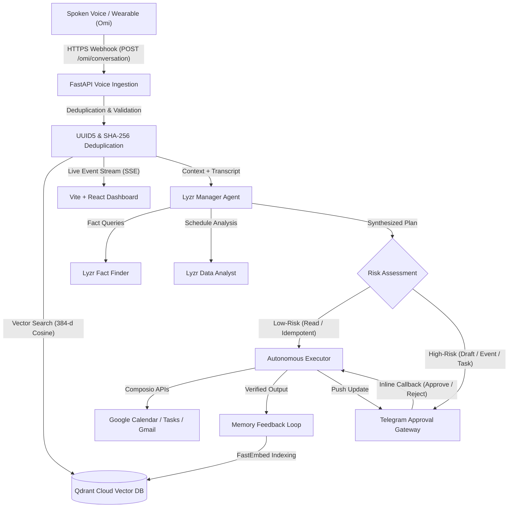

# LifeOS — Voice-Triggered Autonomous Personal AI Operator

[](https://python.org)
[](https://fastapi.tiangolo.com)
[](https://react.dev)
[](https://vitejs.dev)
[](https://qdrant.tech)
[](https://lyzr.ai)
[](#7-automated-test-suite)
[](LICENSE)

> **Event:** Stop Prompting, Solo Agents Hackathon 2026  
> **Track:** Track 2 — Collaborative Multi-Agent Workflows  
> **Core Architecture:** Omi (Voice Ingestion) + Qdrant Cloud (Persistent Memory) + Lyzr Multi-Agent Triad (Manager, Fact Finder, Data Analyst) + Composio (Google Calendar, Tasks, Gmail) + Telegram (Human-in-the-Loop Gateway) + Vite/React (Real-time SSE Dashboard)

LifeOS is an autonomous, voice-triggered personal AI operator. The primary trigger is a completed voice conversation received through the **Omi wearable or mobile app**. 

After the user speaks, LifeOS autonomously:
1. Ingests and deduplicates the transcript using deterministic SHA-256 and UUID5 hashing.
2. Retrieves personal context from **Qdrant Cloud** via FastEmbed (`BAAI/bge-small-en-v1.5`, 384-d).
3. Coordinates the **Lyzr Multi-Agent Triad** (Manager, Fact Finder, Data Analyst) to formulate an execution plan.
4. Executes authorized low-risk operations autonomously (Google Tasks, Calendar reads).
5. Pauses high-risk operations (Gmail Draft creation) for **Telegram approval with interactive inline buttons**.
6. Verifies results against live external APIs (read-back verification).
7. Loops verified outcomes back into persistent vector memory.
8. Displays the full 10-node execution pipeline in real-time on the web dashboard via **Server-Sent Events (SSE)**.

**The user never has to click "Run LifeOS Operator" or approve ordinary tasks in the web dashboard.** The web dashboard provides live observability, while Telegram serves as the mobile approval and clarification interface.

---

## 1. System Architecture



---

## 2. 10 Connected Pipeline Nodes

The live dashboard renders end-to-end execution across 10 deterministic states:

```mermaid
flowchart LR
    N1["1. Voice Received"] --> N2["2. Stored"]
    N2 --> N3["3. Memory Retrieved"]
    N3 --> N4["4. Manager Planning"]
    N4 --> N5["5. Fact Finding"]
    N5 --> N6["6. Data Analysis"]
    N6 --> N7["7. Staged Actions"]
    N7 --> N8["8. Execution & Verification"]
    N8 --> N9["9. Memory Persistence"]
    N9 --> N10["10. Final Delivery"]
```



| # | Node Label | Type | Description |
| :-: | :--- | :---: | :--- |
| **1** | **Voice Received** | Autonomous | Ingests spoken conversation from Omi app via webhook with tenant authentication. |
| **2** | **Transcript Stored** | Autonomous | Deduplicates and commits speech segments to Qdrant Cloud. |
| **3** | **Memory Retrieved** | Autonomous | Semantic search across personal memories for relevant context (threshold ≥ 0.40). |
| **4** | **Lyzr Manager Planning** | Autonomous | Synthesizes an executive plan and determines required actions. |
| **5** | **Fact Finder Working** | Autonomous | Grounded evidence extraction and acoustic speech normalization. |
| **6** | **Data Analyst Working** | Autonomous | Calendar schedule density, free-slot calculation, and risk classification. |
| **7** | **Actions Staged** | Autonomous | Staged operations ready for execution or authorization. |
| **8** | **Execution & Verification** | Hybrid | Low-risk runs autonomously; high-risk pauses for Telegram inline approval. |
| **9** | **Memory Persisted** | Autonomous | Verified execution results are looped back into Qdrant Cloud vector memory. |
| **10** | **Delivery Completed** | Autonomous | Final confirmation pushed to Telegram and web dashboard. |

---

## 3. Autonomous Action Policy Matrix

| Category | Operations | Autonomous Execution | Approval Mechanism |
| :--- | :--- | :---: | :--- |
| **Low-Risk** | Memory retrieval, Calendar event reading, Google Tasks retrieval, clearly specified task creation. | **YES** | Runs automatically; no dashboard click required. |
| **High-Risk** | Gmail draft creation (`GMAIL_CREATE_EMAIL_DRAFT`). | **NO** | Interactive message to Telegram with `[Approve]` and `[Reject]` buttons. |
| **Ambiguous** | Missing recipient, ambiguous event time. | **NO** | Telegram clarification question; resumes upon reply. |
| **Restricted** | Auto-sending emails, deleting calendar events, financial transactions. | **NEVER** | Explicitly blocked by policy engine. |

---

## 4. Collaborative Multi-Agent Triad (Lyzr)

| Agent | Lyzr Agent ID | Role & Responsibilities |
| :--- | :--- | :--- |
| **LifeOS Manager Agent** | `6acdcd0f8a6a8741bd6df3df` | Overall intent classification, plan synthesis, and specialist task delegation. |
| **Fact Finder Specialist** | `6acd9f07cb0aafc9293bd126` | Context extraction from Qdrant, entity extraction, and acoustic normalization. |
| **Data Analyst Specialist** | `6acd1ec70b4f09cf4da21e21` | Calendar density analysis, work-hour free slot calculation (9 AM - 6 PM), and RFC3339 formatting. |

---

## 5. Repository Structure

```
lifeos/
├── .env.example                  # Root sanitized environment template
├── .gitignore                    # Secrets, caches, databases, virtual environments
├── CHANGELOG.md                  # Project version history
├── CONTRIBUTING.md               # Contribution guidelines and test commands
├── LICENSE                       # Apache 2.0 Open Source License
├── README.md                     # Project overview and quick start
├── railway.json                  # Railway one-click deployment spec
├── render.yaml                   # Render blueprint specification
├── vercel.json                   # Root Vercel build & SPA rewrite config
│
├── backend/                      # FastAPI ASGI Application
│   ├── Dockerfile                # Production Python 3.12 container
│   ├── requirements.txt          # Pinned dependencies
│   ├── .env.example              # Backend environment template
│   ├── app/
│   │   ├── main.py               # FastAPI entrypoint, CORS, exception handlers
│   │   ├── config.py             # Pydantic settings & environment validation
│   │   ├── models/               # Pydantic & SQLAlchemy models (UserDB, WorkflowDB, ActionDB)
│   │   ├── routers/              # API routers (auth, omi, workflows, actions, lifeos)
│   │   ├── services/             # Core services (workflow, action, memory, lyzr, telegram, crypto, db)
│   │   └── utils/                # Calendar math, date parsing, time slots
│   └── tests/                    # Automated test suite (74 tests)
│
├── frontend/                     # React 18 + Vite + TypeScript Dashboard
│   ├── vercel.json               # Frontend-specific Vercel configuration
│   ├── package.json              # Frontend dependencies
│   ├── src/
│   │   ├── config/apiConfig.ts   # Central dynamic API base URL resolver (VITE_API_BASE_URL)
│   │   ├── services/api.ts       # Central API client & SSE URL generator
│   │   ├── components/           # UI components (Aurora background, Live Pipeline, Integrations)
│   │   └── App.tsx               # Main application container
│
└── docs/                         # Comprehensive Documentation Suite
    ├── architecture.md           # Deep-dive architecture & Mermaid specifications
    ├── SETUP.md                  # Local development and testing guide
    ├── VERCEL_DEPLOYMENT.md      # Vercel deployment walkthrough
    ├── BACKEND_DEPLOYMENT.md     # Cloud container deployment (Railway / Render / Docker)
    ├── OMI_SETUP.md              # Omi wearable webhook configuration
    ├── TELEGRAM_SETUP.md         # Telegram BotFather & pairing guide
    ├── QDRANT_SETUP.md           # Qdrant Cloud setup & vector isolation
    ├── LYZR_SETUP.md             # Lyzr Studio agent triad configuration
    ├── SECURITY.md               # Security architecture, encryption, & threat model
    └── DEPLOYMENT_AUDIT.md       # Pre-deployment verification audit report
```

---

## 6. Quick Start (Local Development)

### Backend
```bash
cd backend
python3 -m venv .venv
source .venv/bin/activate
pip install -r requirements.txt
cp .env.example .env
# Edit .env with your credentials
uvicorn app.main:app --host 0.0.0.0 --port 8000 --reload
```

### Frontend
```bash
cd frontend
npm install
cp .env.example .env
# Ensure VITE_API_BASE_URL=http://localhost:8000
npm run dev
# Open http://localhost:5173
```

---

## 7. Automated Test Suite

Run all 74 unit, integration, and security tests:

```bash
backend/.venv/bin/pytest backend/tests -v
```

```
============================== 74 passed in 5.50s ==============================
```

Coverage highlights:
- Multi-user signup, login, profile, and JWT authentication.
- Fernet AES-128 credential encryption at rest and masked responses.
- Tenant isolation and dedicated Omi v2 webhook token routing.
- Voice-triggered workflow execution on completed Omi conversation.
- SHA-256 and UUID5 transcript deduplication.
- Autonomous low-risk calendar and task execution without dashboard clicks.
- Telegram inline approval callback handling and clarification pauses.
- Real-time Server-Sent Events (SSE) stream delivery.
- Database persistence for workflows and actions across restarts.

---

## 8. Deployment Guides

- [Frontend Vercel Deployment Guide](docs/VERCEL_DEPLOYMENT.md)
- [Backend Production Deployment Guide](docs/BACKEND_DEPLOYMENT.md)
- [Omi Mobile App Webhook Guide](docs/OMI_SETUP.md)
- [Telegram Bot & Pairing Guide](docs/TELEGRAM_SETUP.md)
- [Qdrant Cloud Setup Guide](docs/QDRANT_SETUP.md)
- [Lyzr Agent Triad Configuration](docs/LYZR_SETUP.md)
- [Security Architecture & Threat Model](docs/SECURITY.md)

---

## 9. Five-Minute Hackathon Demo Script

| Time | Action | What Happens Under the Hood |
| :--- | :--- | :--- |
| **0:00** | **Voice Trigger via Omi** | User speaks: *"Check my Google calendar for tomorrow. Tell me what meetings I have and how much free time is available."* |
| **0:15** | **Webhook Ingestion** | Omi sends webhook to `/omi/conversation`. LifeOS validates tenant token and computes SHA-256 idempotency hash. |
| **0:30** | **Agent Triad Coordination** | Qdrant retrieves past context. Lyzr Manager, Fact Finder, and Data Analyst collaborate to resolve date boundaries and format queries. |
| **1:00** | **Autonomous Execution** | Calendar read action executes autonomously via Composio. Focus free slots and meeting density are computed. |
| **1:30** | **Memory Loopback** | Verified results are vectorized via FastEmbed (384-d) and committed back to Qdrant Cloud. |
| **2:00** | **Telegram Delivery** | Summary digest is pushed directly to the user's Telegram chat via `@Ididhswkje_bot`. |
| **2:30** | **Live Observability** | Web dashboard updates all 10 nodes to green in real time via SSE without requiring manual refreshes or dashboard clicks. |

---

## 10. License

LifeOS is open source software licensed under the [Apache License 2.0](LICENSE).
