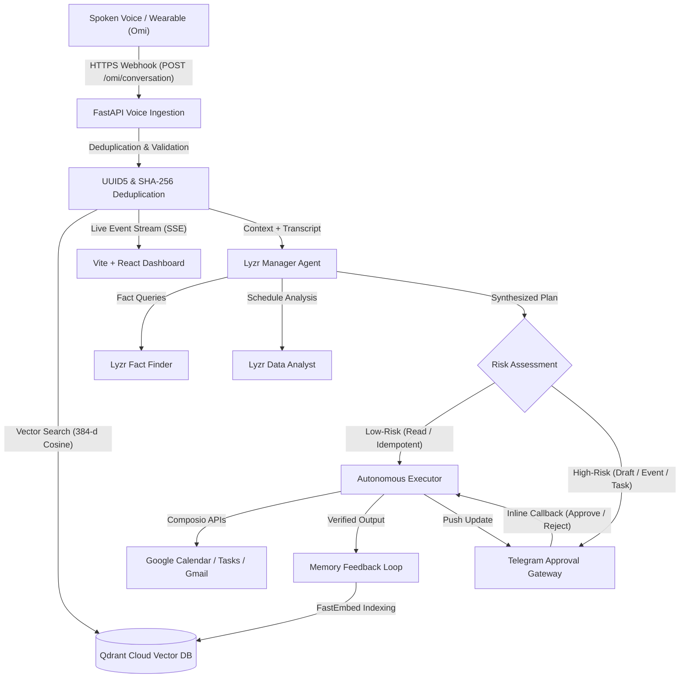
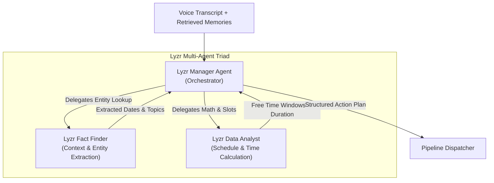
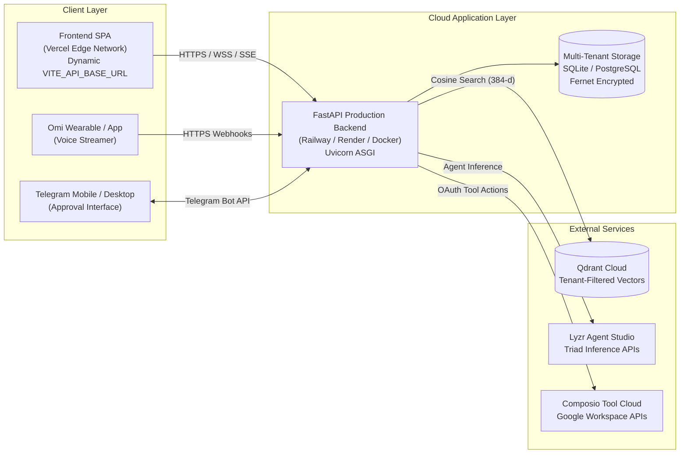

# LifeOS — Architecture & Technical Specifications

> **Project:** LifeOS — Voice-Triggered Autonomous Personal AI Operator  
> **Hackathon:** Stop Prompting, Solo Agents Hackathon 2026  
> **Track:** Track 2 — Collaborative Multi-Agent Workflows  

---

## 1. System Overview

LifeOS is an autonomous, voice-first personal AI operator. Spoken requests captured through the **Omi** wearable or mobile application are ingested via webhooks, enriched with persistent semantic memories from **Qdrant Cloud**, orchestrated through a collaborative **Lyzr Multi-Agent Triad**, and executed against real-world productivity tools (Google Calendar, Google Tasks, Gmail) with human-in-the-loop oversight managed via **Telegram**.



---

## 2. 10-Connected-Node Execution Pipeline

Every spoken conversation progresses sequentially through 10 deterministic states broadcast via Server-Sent Events (SSE) to the frontend:

```mermaid
flowchart LR
    N1["1. Voice Received"] --> N2["2. Stored"]
    N2 --> N3["3. Memory Retrieved"]
    N3 --> N4["4. Manager Planning"]
    N4 --> N5["5. Fact Finding"]
    N5 --> N6["6. Data Analysis"]
    N6 --> N7["7. Staged Actions"]
    N7 --> N8["8. Execution & Verification"]
    N8 --> N9["9. Memory Persistence"]
    N9 --> N10["10. Final Delivery"]
```



### Stage Details

| Node | Stage Identifier | Purpose & Action | Fail-Safe Behavior |
| :--- | :--- | :--- | :--- |
| **1** | `voice_received` | Ingests Omi conversation payload, validates signature and tenant token | Rejects unauthorized webhook requests with HTTP 401 |
| **2** | `transcript_stored` | Computes deterministic SHA-256 idempotency hash; deduplicates repeats | Returns existing workflow without duplicate execution |
| **3** | `memory_retrieved` | Embeds query via FastEmbed (`bge-small-en-v1.5`), retrieves top-5 memories | Injects `NO_RELEVANT_MEMORIES` context if similarity < 0.40 |
| **4** | `lyzr_manager_planning` | Lyzr Manager synthesizes query intent into structured multi-step plan | Falls back to deterministic intent parser if agent times out |
| **5** | `lyzr_fact_finder` | Fact Finder retrieves verified context, entity dates, and calendar bounds | Proceeds with extracted entities if specialist response is empty |
| **6** | `lyzr_data_analyst` | Data Analyst performs schedule analysis, free time math, slot computation | Standardizes date bounds to RFC3339 format |
| **7** | `actions_staged` | Stages actionable operations (Calendar Read, Task Create, Gmail Draft) | Requires explicit user boundary confirmation |
| **8** | `actions_executed` | Executes verified actions; low-risk runs automatically, high-risk awaits approval | Dispatches Telegram inline buttons for approvals |
| **9** | `memory_persisted` | Writes verified execution results back to Qdrant Cloud | Continues pipeline if Qdrant write encounters transient error |
| **10** | `delivery_completed` | Sends final execution digest to user's Telegram chat and SSE stream | Displays completed workflow in web dashboard |

---

## 3. Collaborative Multi-Agent Triad

The system uses three specialized Lyzr agents configured in a hierarchical delegation architecture:



1. **Lyzr Manager Agent**: Deconstructs high-level voice transcripts into tactical sub-tasks, assigns responsibilities to specialist agents, and consolidates the final action plan.
2. **Lyzr Fact Finder Agent**: Extracts dates, attendees, email targets, and reconciles spoken requests against prior conversation history stored in Qdrant.
3. **Lyzr Data Analyst Agent**: Computes duration deltas, evaluates calendar density, calculates free time blocks (9:00 AM - 6:00 PM), and formats output in RFC3339 timestamps.

---

## 4. Autonomous vs. Supervised Action Lifecycle

LifeOS distinguishes between read-only/autonomous actions and state-mutating actions requiring human authorization:

```mermaid
sequenceDiagram
    autonumber
    actor User as User (Voice / Omi)
    participant Core as LifeOS Core
    participant Telegram as Telegram Bot
    participant Composio as Google / Composio API
    participant Qdrant as Qdrant Cloud

    User->>Core: "Check my calendar tomorrow and draft an email to Sarah"
    Core->>Core: Stage Actions: [ReadCalendar, CreateDraft]
    
    rect rgb(20, 40, 20)
        Note over Core,Composio: Low-Risk Action (Autonomous)
        Core->>Composio: Execute list_calendar_events()
        Composio-->>Core: 2 events found, 5.5h free time
        Core->>Qdrant: Index verified calendar result
        Core->>Telegram: Send calendar summary to user
    end

    rect rgb(40, 30, 10)
        Note over Core,Telegram: High-Risk Action (Supervised)
        Core->>Telegram: Send Approval Request [Approve] [Reject]
        User->>Telegram: Clicks [Approve]
        Telegram->>Core: Callback query: approve_act-9f2b
        Core->>Composio: Execute create_gmail_draft()
        Composio-->>Core: Draft created (id: draft-3312)
        Core->>Qdrant: Index verified email draft creation
        Core->>Telegram: "Draft successfully created!"
    end
```



---

## 5. Production Multi-Tenant Topology



---

## 6. Multi-Tenant Isolation Architecture

1. **User Scoping**: Every database entity (`UserDB`, `UserIntegrationDB`, `WorkflowDB`, `ActionDB`) includes a required `user_id` foreign key.
2. **Credential Encryption**: User API keys, Google tokens, and private secrets are encrypted at rest using **Fernet AES-128-CBC** with a server-side PBKDF2 derived key.
3. **Vector Payload Filtering**: Every vector point stored in Qdrant Cloud includes a mandatory `{ "uid": "<user_id>" }` metadata tag. Search and scroll operations always execute with a strict filter condition:
   ```python
   Filter(must=[FieldCondition(key="uid", match=MatchValue(value=current_user_id))])
   ```
4. **SSE Channel Filtering**: The Server-Sent Events stream `/api/lifeos/events?token=<jwt>` filters events server-side, broadcasting only workflow updates belonging to the authenticated JWT subject.
